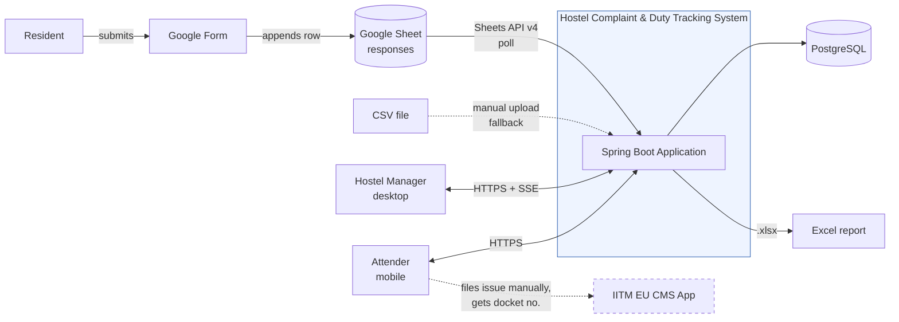
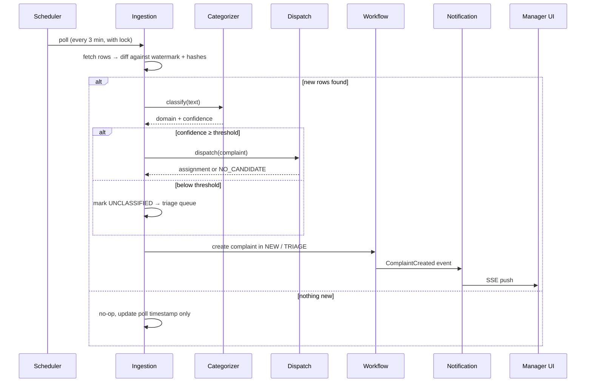
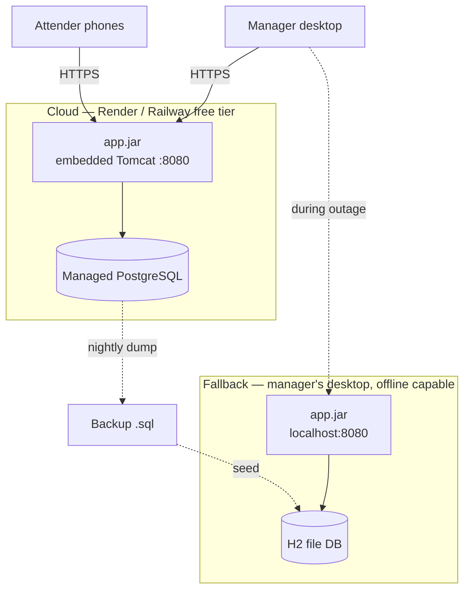

# 2. System Architecture

## 2.1 Architectural style

A **modular monolith** deployed as a single Spring Boot executable jar, organised internally into
bounded modules with explicit interfaces between them.

This is a deliberate choice over microservices. At NFR-1 scale (≤50 complaints/day, 4 attenders) a
distributed system would add network failure modes, deployment complexity and eventual-consistency
problems in exchange for scalability we will never need. The modular boundaries below give us the
separation-of-concerns benefit without the operational cost, and they are drawn so that a module
*could* be extracted later if that ever became necessary.

Within each module we use **ports and adapters (hexagonal)** where — and only where — an external
system is involved. This is not decoration: the ingestion port is what allows the Google Sheets
adapter and the CSV fallback adapter (proposal §10, Plan B) to share one normalization, dedupe and
categorization pipeline instead of drifting into two code paths.

## 2.2 Context diagram



The dashed edge to the CMS app is important: there is **no programmatic integration**. The attender
files the complaint there by hand and types the resulting docket number into our system. We store
it for traceability but can never verify it upstream (see OQ-1).

## 2.3 Module breakdown


| Module | Java package | Responsibility | Key invariant it owns |
|---|---|---|---|
| **ingestion** | `...ingestion` | Fetch raw rows, detect deltas, normalize into complaints | A source row is never turned into two complaints |
| **categorization** | `...categorization` | Assign a domain and confidence to complaint text | Low confidence never silently becomes a wrong domain |
| **dispatch** | `...dispatch` | Score attenders, produce assignments | Every complaint gets an assignment *or* a recorded triage reason |
| **workflow** | `...workflow` | Complaint/task state machine, guards, transitions | Only legal transitions occur; transitions are atomic with their side effects |
| **ledger** | `...ledger` | Point movements, leaderboard projection | Append-only; no double-credit; balance is derived, never stored |
| **analytics** | `...analytics` | MTTR, bottlenecks, anomaly detection | Read-only over the ledger and audit tables |
| **notification** | `...notification` | Fan-out of domain events to manager SSE streams **and attender Web Push** | Delivery is best-effort; never blocks a transaction |
| **reporting** | `...reporting` | `.xlsx` generation via Apache POI | Reports are point-in-time snapshots, reproducible from stored data |
| **identity** | `...identity` | Users, roles, PINs, device tokens, provisioning | No self-registration; every principal is pre-provisioned |
| **audit** | `...audit` | Append-only event log | Written in the same transaction as the change it records |

**Root package:** `in.ac.iitm.hostel.duty`

## 2.4 Layering rules

```
web (controllers, DTOs, Thymeleaf)
  ↓ may call
application (services, transaction boundaries, orchestration)
  ↓ may call
domain (entities, value objects, state machine, scoring — no Spring, no JPA annotations leaking behaviour)
  ↑ implemented by
infrastructure (JPA repos, Sheets client, POI, SSE)
```

Enforced rules, checked in CI by ArchUnit:

1. `domain` depends on nothing outside itself and the JDK.
2. `web` never touches a repository directly — it goes through `application`.
3. Cross-module calls go through the target module's published service interface, never its
   internal classes or its repositories.
4. `@Transactional` lives in `application`, never in `web` or in a repository.

Rule 4 matters more than it looks: transaction boundaries are where our concurrency guarantees
(§7) are enforced, so they must be in one predictable place.

## 2.5 The pipeline



**Scheduler safety.** Free-tier PaaS instances sleep when idle, so `@Scheduled` polling cannot be
relied on alone. Three mitigations:

1. A **"Sync Now"** button in the manager dashboard triggers ingestion on demand — this is the
   guaranteed path, and it also wakes a sleeping instance.
2. On startup the app runs a **catch-up ingestion**, so a wake after sleep loses nothing. Because
   the delta algorithm (§5.3) is watermark-and-hash based rather than time based, a long gap is
   handled identically to a short one.
3. Scheduled jobs take a **database-backed lock** (ShedLock) before running, so if the platform
   ever runs two instances they cannot double-ingest.

## 2.6 Deployment topology



| Concern | Cloud (primary) | Local (fallback) |
|---|---|---|
| Database | Managed PostgreSQL | H2 file mode |
| Sheets ingestion | Active, polled | Disabled — CSV upload only |
| Authentication | Local credentials | Local credentials — **works with no internet**, which is why OAuth was rejected (ADR-002) |
| Purpose | Day-to-day operation | Business continuity during an outage |

The fallback profile is why D1 keeps H2 in the picture at all. The schema is deliberately
constrained to the **portable subset** of SQL that both engines support (§3.7), and Flyway
migrations carry no vendor-specific DDL.

## 2.7 Cross-cutting concerns

| Concern | Approach |
|---|---|
| **Configuration** | Spring profiles: `local`, `cloud`, `offline`. All tunables (dispatch weights, thresholds, SLA table, poll interval, CMS regex) are `@ConfigurationProperties`, never constants. |
| **Secrets** | Environment variables only. The Google service-account JSON is supplied as a base64 env var, never a committed file. `.gitignore` blocks the obvious filenames (§11.5). |
| **Migrations** | Flyway, forward-only, versioned. Schema changes never hand-edited. |
| **Errors** | `@ControllerAdvice` maps domain exceptions to the RFC 7807 problem envelope (§9.7). |
| **Observability** | Spring Actuator health/metrics; structured logging with a correlation ID per request and per ingestion run. |
| **Idempotency** | Every state-changing attender action carries a client-generated request key (§7.4). |
