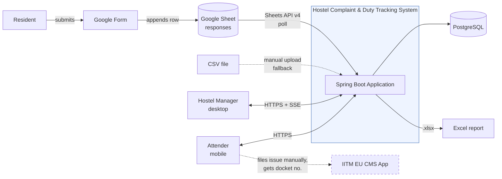
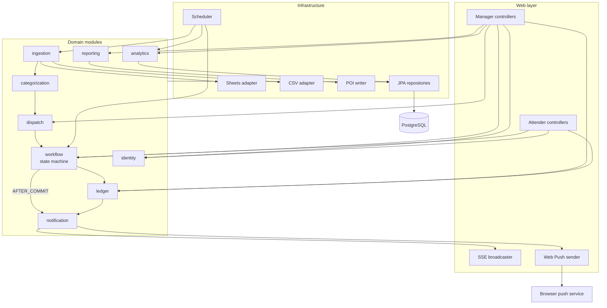
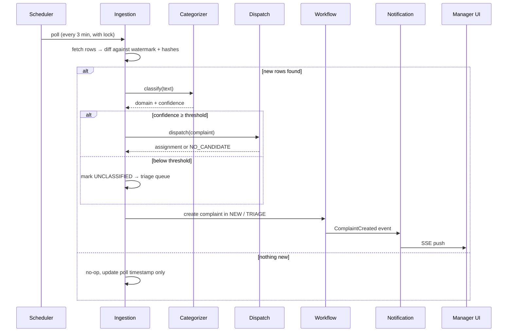
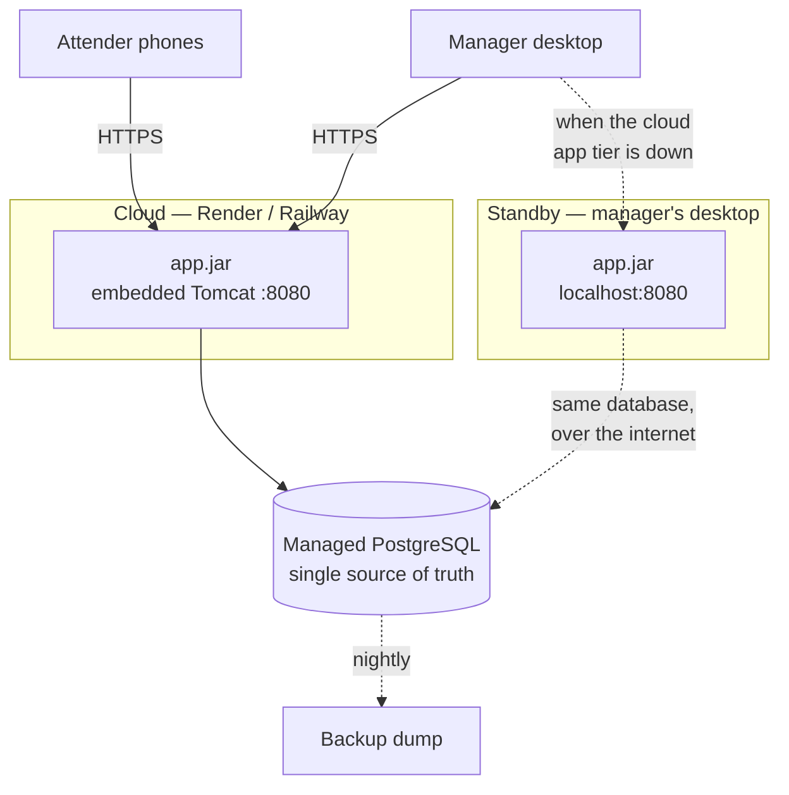

# 2. System Architecture

## 2.1 Architectural style

A **modular monolith** deployed as a single Spring Boot executable jar, organised internally into
bounded modules with explicit interfaces between them.

This is a deliberate choice over microservices. At NFR-1 scale (≤50 complaints/day, 4 attenders) a
distributed system would add network failure modes, deployment complexity and eventual-consistency
problems in exchange for scalability we will never need. The modular boundaries below give us the
separation-of-concerns benefit without the operational cost, and they are drawn so that a module
*could* be extracted later if that ever became necessary.

We use **ports and adapters** at the boundaries where the system talks to the outside world, and
nowhere else.

Ingestion is the clearest example. Complaints arrive two ways: polled from the Google Sheet, or
uploaded as a CSV when the Sheets API is unavailable (proposal §10, Plan B). Different sources, but
both produce the same thing — a list of raw rows. So we define one interface that says exactly that,
`ComplaintSource`, and the two ways of fetching rows become two implementations of it. Everything
downstream — deduplication, categorization, dispatch — is written once, against the interface, and
never learns which source the rows came from.

The alternative is what usually happens without that boundary: the CSV path grows its own copy of
the dedupe and categorization logic. Then a fix lands in one copy and not the other, and the two
quietly disagree. The interface is what makes the fallback path *the same path*, which is also why
re-uploading the same CSV twice cannot create duplicates — it inherits the guarantee rather than
reimplementing it.

## 2.2 Context diagram



The dashed edge to the CMS app is important: there is **no programmatic integration**. The attender
files the complaint there by hand and types the resulting docket number into our system. We store
it for traceability but can never verify it upstream (see OQ-1).

## 2.3 Module breakdown



| Module | Java package | Responsibility | Key invariant it owns |
|---|---|---|---|
| **ingestion** | `...ingestion` | Fetch raw rows, detect deltas, normalize into complaints | A source row is never turned into two complaints |
| **categorization** | `...categorization` | Assign a domain and confidence to complaint text | Low confidence never silently becomes a wrong domain |
| **dispatch** | `...dispatch` | Score attenders, produce assignments | Every complaint gets an assignment *or* a recorded triage reason |
| **workflow** | `...workflow` | Complaint/task state machine, guards, transitions | Only legal transitions occur; transitions are atomic with their side effects |
| **ledger** | `...ledger` | Point movements, leaderboard projection | Append-only; no double-credit; balance is derived, never stored |
| **analytics** | `...analytics` | MTTR, bottlenecks, anomaly detection | Read-only over the ledger and audit tables |
| **notification** | `...notification` | Fan-out of domain events to manager SSE streams **and attender Web Push**, on `AFTER_COMMIT` | Delivery is best-effort; never blocks or rolls back a transaction |
| **reporting** | `...reporting` | `.xlsx` generation via Apache POI | Reports are point-in-time snapshots, reproducible from stored data |
| **identity** | `...identity` | Users, roles, Google allowlist, provisioning | No self-registration; every principal is pre-provisioned |
| **audit** | `...audit` | Append-only event log | Written in the same transaction as the change it records |

**Root package:** `in.ac.iitm.hostel.duty`

## 2.4 Layering rules

```
web (controllers, DTOs, Thymeleaf)
  ↓ may call
application (services, transaction boundaries, orchestration)
  ↓ may call
domain (entities, value objects, state machine, scoring — no Spring, no JPA annotations leaking behaviour)
  ↑ implemented by
infrastructure (JPA repos, Sheets client, POI, SSE)
```

Enforced rules, checked in CI by ArchUnit:

1. `domain` depends on nothing outside itself and the JDK.
2. `web` never touches a repository directly — it goes through `application`.
3. Cross-module calls go through the target module's published service interface, never its
   internal classes or its repositories.
4. `@Transactional` lives in `application`, never in `web` or in a repository.

Rule 4 matters more than it looks: transaction boundaries are where our concurrency guarantees
(§7) are enforced, so they must be in one predictable place.

## 2.5 The pipeline



**Scheduler safety.** Free-tier PaaS instances sleep when idle, so `@Scheduled` polling cannot be
relied on alone. Three mitigations:

1. A **"Sync Now"** button in the manager dashboard triggers ingestion on demand — this is the
   guaranteed path, and it also wakes a sleeping instance.
2. On startup the app runs a **catch-up ingestion**, so a wake after sleep loses nothing. Because
   the delta algorithm (§5.3) is watermark-and-hash based rather than time based, a long gap is
   handled identically to a short one.
3. Scheduled jobs take a **database-backed lock** (ShedLock) before running, so if the platform
   ever runs two instances they cannot double-ingest.

## 2.6 Deployment topology



**One database, two places the application can run.** The standby is the *same jar* with the same
`DATABASE_URL`, started on the manager's desktop when Render or Railway is unavailable. Attenders
lose access during such an outage — they cannot reach `localhost` — but the manager keeps working,
and everything they do lands in the one real database.

| Concern | Cloud (primary) | Standby (manager's desktop) |
|---|---|---|
| Database | Managed PostgreSQL | **The same** managed PostgreSQL |
| Reached by | Attenders and manager, over HTTPS | Manager only, on `localhost` |
| Sheets ingestion | Active, polled | Active — internet is available |
| Notifications | SSE + Web Push | SSE to the manager; push still delivered |
| Authentication | Google sign-in, allowlisted | Google sign-in — `http://localhost:8080/...` is a registered redirect URI |
| Purpose | Day-to-day operation | Continuity when the app tier is down |

This is deliberately the *boring* answer, and it is boring in a useful way. An earlier draft ran the
standby on an embedded H2 database seeded from a nightly dump. That required constraining every
migration to the SQL subset both engines accept, testing two dialects — and it left an unsolved
problem: **work done in the standby had no path back into the cloud database.** Two diverging copies
of the ledger is precisely the kind of bug this system exists to eliminate. Pointing both jars at
one database does not solve that problem; it means the problem cannot arise (ADR-001).

The residual risk is the managed database itself going down, which no amount of application design
fixes. Nightly dumps bound the data loss; for the few hours such an outage lasts the manager falls
back to pen and paper, exactly as they do today, and enters the backlog afterwards.

## 2.7 Cross-cutting concerns

| Concern | Approach |
|---|---|
| **Configuration** | Spring profiles: `local` (dev) and `cloud` (production and standby — identical config bar the bind address). All tunables (dispatch weights, thresholds, SLA table, poll interval, CMS regex) are `@ConfigurationProperties`, never constants. |
| **Secrets** | Environment variables only. The Sheets service-account JSON is supplied as a base64 env var and the OAuth client secret as a plain one — never committed files. `.gitignore` blocks the obvious filenames (§11.5). |
| **Migrations** | Flyway, forward-only, versioned, PostgreSQL-only. Schema changes never hand-edited. |
| **Errors** | `@ControllerAdvice` maps domain exceptions to the RFC 7807 problem envelope (§9.7). |
| **Observability** | Spring Actuator health/metrics; structured logging with a correlation ID per request and per ingestion run. |
| **Idempotency** | Every state-changing attender action carries a client-generated request key (§7.4). |
