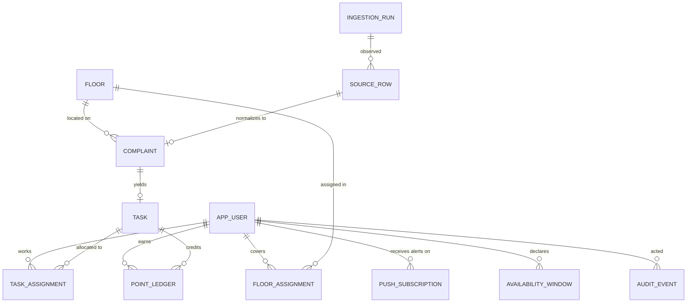

# 3. Data Model

## 3.1 Design principles

1. **Facts are immutable; state is derived.** Point balances are never stored as a mutable counter.
   They are the sum of an append-only ledger. This makes double-crediting a constraint violation
   rather than a race we have to win (§7).
2. **Every mutable aggregate root carries a `version` column** for optimistic locking.
3. **Audit is written inside the same transaction as the change**, so the log can never disagree
   with the data.
4. **No hard deletes** on operational data. Rows are tombstoned so the audit trail stays intact.
5. **PostgreSQL only.** Since the standby runs against the same managed database (§2.6), there is
   no second engine to accommodate and we may use Postgres features freely.
6. **Prefer a framework table over a hand-rolled one.** Where Spring Security already defines a
   schema for something, we use it rather than inventing our own (ADR-012).

## 3.2 Entity–relationship diagram



## 3.3 Identity & access

```sql
CREATE TABLE app_user (
    id            BIGINT GENERATED BY DEFAULT AS IDENTITY PRIMARY KEY,
    display_name  VARCHAR(128) NOT NULL,
    role          VARCHAR(16)  NOT NULL,   -- MANAGER | ATTENDER
    email         VARCHAR(255) NOT NULL,   -- Google account; the allowlist key
    active        BOOLEAN      NOT NULL DEFAULT TRUE,
    last_login_at TIMESTAMP,
    created_at    TIMESTAMP    NOT NULL,
    created_by    BIGINT       REFERENCES app_user(id),
    version       BIGINT       NOT NULL DEFAULT 0,
    CONSTRAINT uq_user_email UNIQUE (email),
    CONSTRAINT ck_user_role  CHECK (role IN ('MANAGER','ATTENDER'))
);
```

**There is no credential column anywhere in this schema.** Everyone — manager and attenders alike —
authenticates with Google, so `email` is purely an *allowlist key*: a sign-in whose verified email
has no matching active row is rejected. Nothing secret about any user is stored, so a database
breach yields no credential to steal (ADR-002).

There is also **no remember-me table**. Re-authenticating through Google on a device where the
account is already signed in is a single tap with no typing — a persistent-token scheme would add a
table and a rotation protocol to save an interaction that already costs nothing.

**Two `MANAGER` rows are provisioned from day one.** If one Google account becomes inaccessible the
other can still administer, including editing the allowlist. This is the break-glass path, and it
costs a row rather than a second authentication mechanism (§11.2).

There is **no self-registration path**. `app_user` rows are created only by a `MANAGER` through the
provisioning screen, which is the enforcement point for "only a specific set of accounts may access
the system". Google authenticates *who someone is*; this table decides *whether they may in*.

Revoking a lost phone is `active = false`, which blocks the next sign-in immediately and drops the
session at its 12-hour expiry. Push subscriptions for that user are revoked in the same action, so
the phone stops receiving alerts at once (§9.6).

If a user loses access to their Google account, a manager edits `email` to whichever account they
can use. That is the recovery path, and it is worth being clear that it depends on the person having
*some* working Google account — a step that happens outside this system.

## 3.4 Locations, coverage & availability

```sql
CREATE TABLE floor (
    id           BIGINT GENERATED BY DEFAULT AS IDENTITY PRIMARY KEY,
    wing         VARCHAR(16)  NOT NULL,
    floor_number INTEGER      NOT NULL,
    label        VARCHAR(64)  NOT NULL,
    CONSTRAINT uq_floor UNIQUE (wing, floor_number)
);

-- Current coverage only. Coverage is fixed at Cauvery, not rotating (OQ-3 confirmed).
CREATE TABLE floor_assignment (
    id           BIGINT GENERATED BY DEFAULT AS IDENTITY PRIMARY KEY,
    attender_id  BIGINT      NOT NULL REFERENCES app_user(id),
    floor_id     BIGINT      NOT NULL REFERENCES floor(id),
    coverage     VARCHAR(16) NOT NULL,   -- PRIMARY | SECONDARY
    version      BIGINT      NOT NULL DEFAULT 0,
    CONSTRAINT uq_fa      UNIQUE (attender_id, floor_id),
    CONSTRAINT ck_coverage CHECK (coverage IN ('PRIMARY','SECONDARY'))
);
CREATE INDEX ix_fa_lookup ON floor_assignment (floor_id);

CREATE TABLE availability_window (
    id          BIGINT GENERATED BY DEFAULT AS IDENTITY PRIMARY KEY,
    attender_id BIGINT       NOT NULL REFERENCES app_user(id),
    status      VARCHAR(16)  NOT NULL,   -- AVAILABLE | ON_LEAVE | OFF_DUTY
    starts_at   TIMESTAMP    NOT NULL,
    ends_at     TIMESTAMP,
    reason      VARCHAR(255),
    recorded_by BIGINT       NOT NULL REFERENCES app_user(id),
    CONSTRAINT ck_avail_status CHECK (status IN ('AVAILABLE','ON_LEAVE','OFF_DUTY'))
);
CREATE INDEX ix_avail_lookup ON availability_window (attender_id, starts_at, ends_at);
```

Coverage is a plain current-state table. An earlier draft made assignments time-bounded
(`valid_from` / `valid_to`) so that a past dispatch decision could be replayed against the roster in
force at the time — but that put a date filter on every dispatch query to serve a case that does not
arise, since coverage at Cauvery is fixed rather than rotating. Explainability is preserved more
cheaply: `task_assignment.score_snapshot` (§3.6) already records the *computed* score that chose an
attender, which is the thing a manager actually asks about. Reintroducing the temporal dimension
later is an additive migration.

## 3.5 Ingestion & complaints

```sql
CREATE TABLE ingestion_run (
    id            BIGINT GENERATED BY DEFAULT AS IDENTITY PRIMARY KEY,
    source_type   VARCHAR(16) NOT NULL,   -- GOOGLE_SHEETS | CSV_UPLOAD
    trigger_type  VARCHAR(16) NOT NULL,   -- SCHEDULED | MANUAL | STARTUP
    started_at    TIMESTAMP   NOT NULL,
    finished_at   TIMESTAMP,
    rows_seen     INTEGER     NOT NULL DEFAULT 0,
    rows_created  INTEGER     NOT NULL DEFAULT 0,
    rows_skipped  INTEGER     NOT NULL DEFAULT 0,
    status        VARCHAR(16) NOT NULL,   -- RUNNING | SUCCESS | FAILED
    error_detail  VARCHAR(2000),
    triggered_by  BIGINT REFERENCES app_user(id)
);

-- The idempotency anchor for ingestion. One row per observed source record.
CREATE TABLE source_row (
    id             BIGINT GENERATED BY DEFAULT AS IDENTITY PRIMARY KEY,
    source_type    VARCHAR(16)  NOT NULL,
    source_ref     VARCHAR(128) NOT NULL,  -- sheet id, or upload batch id
    response_key   CHAR(64)     NOT NULL,  -- SHA-256(timestamp || reporter email): STABLE identity
    content_hash   CHAR(64)     NOT NULL,  -- SHA-256 of all normalized cells: change detection
    row_index      INTEGER,                -- positional HINT only, never identity (see 5.3)
    raw_payload    TEXT         NOT NULL,  -- JSON string of the original row
    state          VARCHAR(16)  NOT NULL,  -- ACTIVE (AMENDED reserved, see below)
    revision       INTEGER      NOT NULL DEFAULT 1,
    first_seen_run BIGINT       NOT NULL REFERENCES ingestion_run(id),
    last_seen_run  BIGINT       NOT NULL REFERENCES ingestion_run(id),
    first_seen_at  TIMESTAMP    NOT NULL,
    last_seen_at   TIMESTAMP    NOT NULL,
    complaint_id   BIGINT,
    CONSTRAINT uq_source_row UNIQUE (source_type, source_ref, response_key),
    CONSTRAINT ck_sr_state   CHECK (state IN ('ACTIVE','AMENDED'))
);
CREATE INDEX ix_sr_hash ON source_row (content_hash);

CREATE TABLE complaint (
    id                BIGINT GENERATED BY DEFAULT AS IDENTITY PRIMARY KEY,
    public_ref        VARCHAR(24)  NOT NULL,   -- e.g. CAU-2026-0417, shown to humans
    source_row_id     BIGINT       REFERENCES source_row(id),
    raw_text          TEXT         NOT NULL,
    reported_at       TIMESTAMP    NOT NULL,
    reporter_room     VARCHAR(32),
    reporter_name     VARCHAR(128),           -- shown to the assigned attender (§11.4)
    reporter_roll_no  VARCHAR(32),            -- shown to the assigned attender (§11.4)
    reporter_phone    VARCHAR(32),            -- shown to the assigned attender (§11.4)
    reporter_contact  VARCHAR(128),           -- resident email; purged after 90 days (NFR-9)
    floor_id          BIGINT       REFERENCES floor(id),
    location_note     VARCHAR(255),
    docket_no         VARCHAR(64),            -- IITM EU CMS docket; NULL until filed (§4.3)
    docket_filed_at   TIMESTAMP,
    docket_filed_by   BIGINT       REFERENCES app_user(id),
    domain            VARCHAR(16)  NOT NULL,  -- ELECTRICAL|CIVIL|RO_PLANT|NETWORK|UNCLASSIFIED
    domain_confidence NUMERIC(4,3),           -- 0.000 .. 1.000
    classified_by     VARCHAR(16)  NOT NULL,  -- RULES | MANUAL | FALLBACK
    priority          VARCHAR(8)   NOT NULL,  -- P1 | P2 | P3
    base_priority     VARCHAR(8)   NOT NULL,  -- before aging, kept for explainability
    status            VARCHAR(24)  NOT NULL,
    sla_due_at        TIMESTAMP,
    sla_breached      BOOLEAN      NOT NULL DEFAULT FALSE,
    created_at        TIMESTAMP    NOT NULL,
    updated_at        TIMESTAMP    NOT NULL,
    closed_at         TIMESTAMP,
    version           BIGINT       NOT NULL DEFAULT 0,
    CONSTRAINT uq_complaint_ref UNIQUE (public_ref),
    CONSTRAINT ck_domain   CHECK (domain IN
        ('ELECTRICAL','CIVIL','RO_PLANT','NETWORK','UNCLASSIFIED')),
    CONSTRAINT ck_priority CHECK (priority IN ('P1','P2','P3')),
    CONSTRAINT ck_conf     CHECK (domain_confidence IS NULL
                                  OR (domain_confidence >= 0 AND domain_confidence <= 1))
);
CREATE INDEX ix_complaint_status ON complaint (status, priority, reported_at);
CREATE INDEX ix_complaint_domain ON complaint (domain, created_at);
CREATE INDEX ix_complaint_sla    ON complaint (sla_due_at, sla_breached);
```

`reporter_name`, `reporter_roll_no` and `reporter_phone` let the assigned attender identify the
student and reach them for access or clarification. They are **not** exposed on the leaderboard, in
push payloads or in analytics, and the attender's view of them expires 7 days after resolution while
the manager keeps them with the complaint record (§11.4).

`complaint.raw_text` keeps the resident's original wording verbatim. The classifier's output is
stored *alongside* it with a confidence score and the method used, never in place of it — so a
misclassification is always recoverable and the gold-set evaluation in §12.3 can be run
retrospectively over real production data.

## 3.6 Tasks, dockets and the ledger

```sql
CREATE TABLE task (
    id           BIGINT GENERATED BY DEFAULT AS IDENTITY PRIMARY KEY,
    task_type    VARCHAR(16) NOT NULL,     -- COMPLAINT | SPECIAL_DUTY
    complaint_id BIGINT REFERENCES complaint(id),
    title        VARCHAR(255) NOT NULL,
    description  TEXT,
    point_value  INTEGER     NOT NULL,     -- +2 default for complaints; custom for duties
    shared       BOOLEAN     NOT NULL DEFAULT FALSE,
    status       VARCHAR(24) NOT NULL,
    opens_at     TIMESTAMP,
    closes_at    TIMESTAMP,
    created_by   BIGINT      NOT NULL REFERENCES app_user(id),
    created_at   TIMESTAMP   NOT NULL,
    version      BIGINT      NOT NULL DEFAULT 0,
    CONSTRAINT ck_task_type CHECK (task_type IN ('COMPLAINT','SPECIAL_DUTY')),
    CONSTRAINT ck_task_link CHECK (
        (task_type = 'COMPLAINT'    AND complaint_id IS NOT NULL) OR
        (task_type = 'SPECIAL_DUTY' AND complaint_id IS NULL))
);

CREATE TABLE task_assignment (
    id           BIGINT GENERATED BY DEFAULT AS IDENTITY PRIMARY KEY,
    task_id      BIGINT      NOT NULL REFERENCES task(id),
    attender_id  BIGINT      NOT NULL REFERENCES app_user(id),
    assign_method VARCHAR(16) NOT NULL,    -- AUTO | MANUAL | CLAIMED
    assigned_by  BIGINT      REFERENCES app_user(id),
    assigned_at  TIMESTAMP   NOT NULL,
    status       VARCHAR(16) NOT NULL,     -- ACTIVE | RELEASED | COMPLETED
    score_snapshot TEXT,                   -- JSON of the dispatch score that chose them
    version      BIGINT      NOT NULL DEFAULT 0,
    CONSTRAINT uq_task_attender UNIQUE (task_id, attender_id),
    CONSTRAINT ck_asg_method CHECK (assign_method IN ('AUTO','MANUAL','CLAIMED'))
);

CREATE INDEX ix_docket_no ON complaint (docket_no);
```

The docket lives in **three columns on `complaint`**, not a child table. Attenders do mistype
numbers on phones, and the correction must be recoverable — but the audit log already records every
change with its before and after values (§3.7), so a separate history table with a `superseded_at`
column would store the same fact twice. An earlier draft also gave the docket its own five-state
machine including a `VERIFIED` state that, by its own definition, gated nothing. Both are gone
(ADR-012); traceability is unchanged, and "who filed which number, when, and what it was corrected
from" is answered by one query against `audit_event`.

```sql
-- Append-only. No UPDATE, no DELETE. Reversals are new rows with negated points.
CREATE TABLE point_ledger (
    id              BIGINT GENERATED BY DEFAULT AS IDENTITY PRIMARY KEY,
    attender_id     BIGINT       NOT NULL REFERENCES app_user(id),
    task_id         BIGINT       REFERENCES task(id),
    reason_code     VARCHAR(32)  NOT NULL,  -- see table below
    points          INTEGER      NOT NULL,
    effective_date  DATE         NOT NULL,  -- Asia/Kolkata business date (NFR-7)
    period_key      CHAR(7)      NOT NULL,  -- 'YYYY-MM', derived from effective_date
    note            VARCHAR(500),
    idempotency_key VARCHAR(128) NOT NULL,
    reverses_id     BIGINT       REFERENCES point_ledger(id),
    created_by      BIGINT       NOT NULL REFERENCES app_user(id),
    created_at      TIMESTAMP    NOT NULL,
    CONSTRAINT uq_ledger_idem   UNIQUE (idempotency_key),
    CONSTRAINT ck_ledger_reason CHECK (reason_code IN
        ('COMPLAINT_RESOLVED','SPECIAL_DUTY','PENALTY','MANUAL_ADJUSTMENT','REVERSAL'))
);
CREATE INDEX ix_ledger_period  ON point_ledger (period_key, attender_id);
CREATE INDEX ix_ledger_att     ON point_ledger (attender_id, effective_date);
```

| `reason_code` | Points | Raised by | Idempotency key |
|---|---|---|---|
| `COMPLAINT_RESOLVED` | +2 (configurable) | Workflow, on transition to `RESOLVED` | `RESOLVE:{task_id}:{attender_id}` |
| `SPECIAL_DUTY` | `task.point_value` | Workflow, on special-duty completion | `DUTY:{task_id}:{attender_id}` |
| `PENALTY` | −1 (configurable) | Manager | `PENALTY:{uuid}` from the request |
| `MANUAL_ADJUSTMENT` | any | Manager, with mandatory note | `ADJ:{uuid}` |
| `REVERSAL` | negation of target | Manager | `REV:{reverses_id}` |

**This table is the core integrity mechanism.** Because the key for an automatic credit is derived
deterministically from the task and attender, a retried mobile request — the realistic failure mode
on patchy hostel Wi-Fi — collides on `uq_ledger_idem` and is swallowed as a no-op. Double-crediting
is not a race we have to win; it is structurally impossible. See §7.3 for the full argument.

## 3.7 Audit and classifier data

```sql
CREATE TABLE audit_event (
    id             BIGINT GENERATED BY DEFAULT AS IDENTITY PRIMARY KEY,
    occurred_at    TIMESTAMP   NOT NULL,
    actor_id       BIGINT REFERENCES app_user(id),  -- NULL = system
    actor_role     VARCHAR(16),
    entity_type    VARCHAR(32) NOT NULL,
    entity_id      BIGINT      NOT NULL,
    event_type     VARCHAR(48) NOT NULL,
    from_state     VARCHAR(24),
    to_state       VARCHAR(24),
    detail         TEXT,                            -- JSON string
    correlation_id VARCHAR(64)
);
CREATE INDEX ix_audit_entity ON audit_event (entity_type, entity_id, occurred_at);
CREATE INDEX ix_audit_time   ON audit_event (occurred_at);

-- Web Push endpoints. One row per (attender, browser install). See §9.7.
CREATE TABLE push_subscription (
    id           BIGINT GENERATED BY DEFAULT AS IDENTITY PRIMARY KEY,
    user_id      BIGINT       NOT NULL REFERENCES app_user(id),
    endpoint     VARCHAR(512) NOT NULL,   -- push service URL issued by the browser
    p256dh_key   VARCHAR(128) NOT NULL,   -- client public key (payload encryption)
    auth_secret  VARCHAR(64)  NOT NULL,   -- client auth secret
    device_label VARCHAR(64),
    created_at   TIMESTAMP    NOT NULL,
    last_ok_at   TIMESTAMP,
    fail_count   INTEGER      NOT NULL DEFAULT 0,
    revoked_at   TIMESTAMP,
    CONSTRAINT uq_push_endpoint UNIQUE (endpoint)
);
CREATE INDEX ix_push_user ON push_subscription (user_id, revoked_at);

-- Classifier lexicon, editable by the manager without a redeploy (§5.5)
CREATE TABLE category_term (
    id         BIGINT GENERATED BY DEFAULT AS IDENTITY PRIMARY KEY,
    domain     VARCHAR(16)  NOT NULL,
    term       VARCHAR(64)  NOT NULL,
    weight     NUMERIC(4,2) NOT NULL DEFAULT 1.00,
    fuzzy      BOOLEAN      NOT NULL DEFAULT TRUE,
    active     BOOLEAN      NOT NULL DEFAULT TRUE,
    created_at TIMESTAMP    NOT NULL,
    CONSTRAINT uq_term UNIQUE (domain, term)
);
```

The audit row is written by an `@TransactionalEventListener(BEFORE_COMMIT)` handler, so it commits
atomically with the change it describes and the log can never diverge from the data.

Notifications are the mirror image: they fire on **`AFTER_COMMIT`**, so a notification can never
describe a transaction that rolled back, and a push service being slow can never hold a database
transaction open. An earlier draft routed them through a transactional outbox table with a
publisher poller and `Last-Event-ID` replay. For one manager watching one dashboard, refetching
current state on reconnect gives the identical user-visible result for a fraction of the machinery
(§9.5, ADR-012).

## 3.8 Retention

| Data | Retention | Mechanism |
|---|---|---|
| `complaint.reporter_name`, `reporter_roll_no`, `reporter_phone` | Hidden from the attender 7 days after resolution; retained on the record for the manager | View-level scoping, not deletion — the manager still needs them for oversight (§11.4) |
| `complaint.reporter_contact` | 90 days | Nightly job nulls the column; audit records the purge |
| `complaint.raw_text` | 1 year | Nightly job replaces with `[purged]`; aggregates survive |
| `audit_event`, `point_ledger` | Indefinite | Required for bonus dispute resolution |
| `push_subscription` | Until revoked or 3 consecutive failures | Auto-pruned; endpoint is a device identifier (§11.4) |
| `source_row.raw_payload` | 90 days | Purged; `content_hash` retained so dedupe still works |

Purging `raw_payload` but keeping `content_hash` is what lets retention coexist with idempotency:
we can still recognise a previously-seen row without storing what it said.
