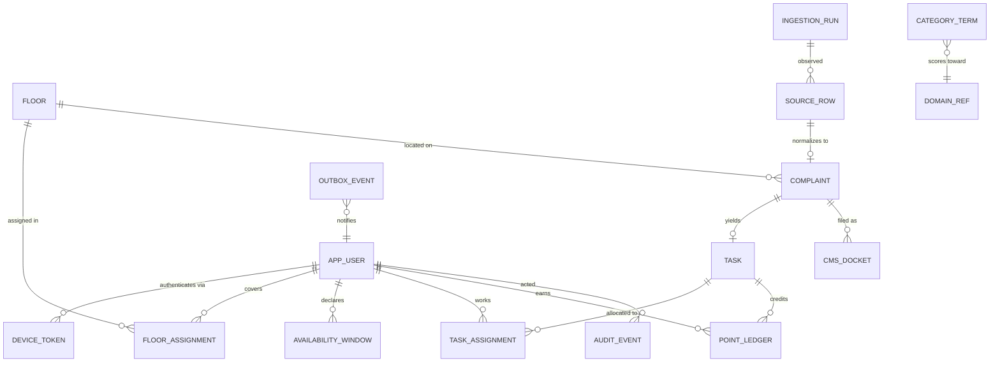

# 3. Data Model

## 3.1 Design principles

1. **Facts are immutable; state is derived.** Point balances are never stored as a mutable counter.
   They are the sum of an append-only ledger. This makes double-crediting a constraint violation
   rather than a race we have to win (§7).
2. **Every mutable aggregate root carries a `version` column** for optimistic locking.
3. **Audit is written inside the same transaction as the change**, so the log can never disagree
   with the data.
4. **No hard deletes** on operational data. Rows are tombstoned so the audit trail stays intact.
5. **Portable SQL only.** DDL must run on both PostgreSQL and H2 (§3.7).

## 3.2 Entity–relationship diagram



## 3.3 Identity & access

```sql
CREATE TABLE app_user (
    id              BIGINT GENERATED BY DEFAULT AS IDENTITY PRIMARY KEY,
    username        VARCHAR(64)  NOT NULL,
    display_name    VARCHAR(128) NOT NULL,
    role            VARCHAR(16)  NOT NULL,   -- MANAGER | ATTENDER
    password_hash   VARCHAR(72),             -- BCrypt; MANAGER only
    pin_hash        VARCHAR(72),             -- BCrypt; ATTENDER only
    pin_set_at      TIMESTAMP,
    must_reset_pin  BOOLEAN      NOT NULL DEFAULT FALSE,
    failed_attempts INTEGER      NOT NULL DEFAULT 0,
    locked_until    TIMESTAMP,
    active          BOOLEAN      NOT NULL DEFAULT TRUE,
    created_at      TIMESTAMP    NOT NULL,
    created_by      BIGINT       REFERENCES app_user(id),
    version         BIGINT       NOT NULL DEFAULT 0,
    CONSTRAINT uq_user_username UNIQUE (username),
    CONSTRAINT ck_user_role     CHECK (role IN ('MANAGER','ATTENDER')),
    CONSTRAINT ck_user_cred     CHECK (
        (role = 'MANAGER'  AND password_hash IS NOT NULL) OR
        (role = 'ATTENDER' AND pin_hash      IS NOT NULL))
);

CREATE TABLE device_token (
    id           BIGINT GENERATED BY DEFAULT AS IDENTITY PRIMARY KEY,
    user_id      BIGINT       NOT NULL REFERENCES app_user(id),
    selector     VARCHAR(32)  NOT NULL,   -- lookup half, indexed
    token_hash   VARCHAR(64)  NOT NULL,   -- SHA-256 of the validator half
    label        VARCHAR(64),             -- "Ravi's phone"
    issued_at    TIMESTAMP    NOT NULL,
    expires_at   TIMESTAMP    NOT NULL,
    last_used_at TIMESTAMP,
    revoked_at   TIMESTAMP,
    CONSTRAINT uq_device_selector UNIQUE (selector)
);
CREATE INDEX ix_device_user ON device_token (user_id, revoked_at);
```

There is **no self-registration path**. `app_user` rows are created only by a `MANAGER` through the
provisioning screen, which is the enforcement point for "only a specific set of accounts may
access the system". Because credentials are local, an attender needs no institute account and no
Google account — the requirement to support non-institute people is met by *removing* an external
dependency rather than adding one (ADR-002).

The split-token scheme (`selector` + hashed `validator`) is used rather than a single opaque token
so that lookup is an indexed equality match while the secret half is still only stored hashed. A
stolen database therefore does not yield usable device cookies.

## 3.4 Locations, coverage & availability

```sql
CREATE TABLE floor (
    id           BIGINT GENERATED BY DEFAULT AS IDENTITY PRIMARY KEY,
    wing         VARCHAR(16)  NOT NULL,
    floor_number INTEGER      NOT NULL,
    label        VARCHAR(64)  NOT NULL,
    CONSTRAINT uq_floor UNIQUE (wing, floor_number)
);

-- Time-bounded so that both fixed and rotating allocations are expressible (OQ-3).
CREATE TABLE floor_assignment (
    id           BIGINT GENERATED BY DEFAULT AS IDENTITY PRIMARY KEY,
    attender_id  BIGINT      NOT NULL REFERENCES app_user(id),
    floor_id     BIGINT      NOT NULL REFERENCES floor(id),
    coverage     VARCHAR(16) NOT NULL,   -- PRIMARY | SECONDARY
    valid_from   DATE        NOT NULL,
    valid_to     DATE,                   -- NULL = open ended
    version      BIGINT      NOT NULL DEFAULT 0,
    CONSTRAINT ck_coverage CHECK (coverage IN ('PRIMARY','SECONDARY')),
    CONSTRAINT ck_validity CHECK (valid_to IS NULL OR valid_to >= valid_from)
);
CREATE INDEX ix_fa_lookup ON floor_assignment (floor_id, valid_from, valid_to);

CREATE TABLE availability_window (
    id          BIGINT GENERATED BY DEFAULT AS IDENTITY PRIMARY KEY,
    attender_id BIGINT       NOT NULL REFERENCES app_user(id),
    status      VARCHAR(16)  NOT NULL,   -- AVAILABLE | ON_LEAVE | OFF_DUTY
    starts_at   TIMESTAMP    NOT NULL,
    ends_at     TIMESTAMP,
    reason      VARCHAR(255),
    recorded_by BIGINT       NOT NULL REFERENCES app_user(id),
    CONSTRAINT ck_avail_status CHECK (status IN ('AVAILABLE','ON_LEAVE','OFF_DUTY'))
);
CREATE INDEX ix_avail_lookup ON availability_window (attender_id, starts_at, ends_at);
```

Modelling floor coverage as **time-bounded assignments** rather than a column on the attender means
we do not have to know today whether allocations rotate (OQ-3) — and, critically, it means a
dispatch decision made last month can still be explained using the coverage that was in force
*then*, which a mutable column would have destroyed.

## 3.5 Ingestion & complaints

```sql
CREATE TABLE ingestion_run (
    id            BIGINT GENERATED BY DEFAULT AS IDENTITY PRIMARY KEY,
    source_type   VARCHAR(16) NOT NULL,   -- GOOGLE_SHEETS | CSV_UPLOAD
    trigger_type  VARCHAR(16) NOT NULL,   -- SCHEDULED | MANUAL | STARTUP
    started_at    TIMESTAMP   NOT NULL,
    finished_at   TIMESTAMP,
    rows_seen     INTEGER     NOT NULL DEFAULT 0,
    rows_created  INTEGER     NOT NULL DEFAULT 0,
    rows_amended  INTEGER     NOT NULL DEFAULT 0,
    rows_vanished INTEGER     NOT NULL DEFAULT 0,
    status        VARCHAR(16) NOT NULL,   -- RUNNING | SUCCESS | FAILED
    error_detail  VARCHAR(2000),
    triggered_by  BIGINT REFERENCES app_user(id)
);

-- The idempotency anchor for ingestion. One row per observed source record.
CREATE TABLE source_row (
    id             BIGINT GENERATED BY DEFAULT AS IDENTITY PRIMARY KEY,
    source_type    VARCHAR(16)  NOT NULL,
    source_ref     VARCHAR(128) NOT NULL,  -- sheet id, or upload batch id
    response_key   CHAR(64)     NOT NULL,  -- SHA-256(timestamp || reporter email): STABLE identity
    content_hash   CHAR(64)     NOT NULL,  -- SHA-256 of all normalized cells: change detection
    row_index      INTEGER,                -- positional HINT only, never identity (see 5.3)
    raw_payload    TEXT         NOT NULL,  -- JSON string of the original row
    state          VARCHAR(16)  NOT NULL,  -- ACTIVE | AMENDED | VANISHED
    revision       INTEGER      NOT NULL DEFAULT 1,
    first_seen_run BIGINT       NOT NULL REFERENCES ingestion_run(id),
    last_seen_run  BIGINT       NOT NULL REFERENCES ingestion_run(id),
    first_seen_at  TIMESTAMP    NOT NULL,
    last_seen_at   TIMESTAMP    NOT NULL,
    complaint_id   BIGINT,
    CONSTRAINT uq_source_row UNIQUE (source_type, source_ref, response_key),
    CONSTRAINT ck_sr_state   CHECK (state IN ('ACTIVE','AMENDED','VANISHED'))
);
CREATE INDEX ix_sr_hash ON source_row (content_hash);

-- Amendment history: an edited Form response keeps its response_key but gains a new revision.
CREATE TABLE source_row_revision (
    id            BIGINT GENERATED BY DEFAULT AS IDENTITY PRIMARY KEY,
    source_row_id BIGINT     NOT NULL REFERENCES source_row(id),
    revision      INTEGER    NOT NULL,
    content_hash  CHAR(64)   NOT NULL,
    raw_payload   TEXT       NOT NULL,
    observed_at   TIMESTAMP  NOT NULL,
    observed_run  BIGINT     NOT NULL REFERENCES ingestion_run(id),
    CONSTRAINT uq_srr UNIQUE (source_row_id, revision)
);

CREATE TABLE complaint (
    id                BIGINT GENERATED BY DEFAULT AS IDENTITY PRIMARY KEY,
    public_ref        VARCHAR(24)  NOT NULL,   -- e.g. CAU-2026-0417, shown to humans
    source_row_id     BIGINT       REFERENCES source_row(id),
    raw_text          TEXT         NOT NULL,
    reported_at       TIMESTAMP    NOT NULL,
    reporter_room     VARCHAR(32),
    reporter_contact  VARCHAR(128),           -- purged after 90 days (NFR-9)
    floor_id          BIGINT       REFERENCES floor(id),
    location_note     VARCHAR(255),
    domain            VARCHAR(16)  NOT NULL,  -- ELECTRICAL|CIVIL|RO_PLANT|NETWORK|UNCLASSIFIED
    domain_confidence NUMERIC(4,3),           -- 0.000 .. 1.000
    classified_by     VARCHAR(16)  NOT NULL,  -- RULES | MANUAL | FALLBACK
    priority          VARCHAR(8)   NOT NULL,  -- P1 | P2 | P3
    base_priority     VARCHAR(8)   NOT NULL,  -- before aging, kept for explainability
    status            VARCHAR(24)  NOT NULL,
    sla_due_at        TIMESTAMP,
    sla_breached      BOOLEAN      NOT NULL DEFAULT FALSE,
    created_at        TIMESTAMP    NOT NULL,
    updated_at        TIMESTAMP    NOT NULL,
    closed_at         TIMESTAMP,
    version           BIGINT       NOT NULL DEFAULT 0,
    CONSTRAINT uq_complaint_ref UNIQUE (public_ref),
    CONSTRAINT ck_domain   CHECK (domain IN
        ('ELECTRICAL','CIVIL','RO_PLANT','NETWORK','UNCLASSIFIED')),
    CONSTRAINT ck_priority CHECK (priority IN ('P1','P2','P3')),
    CONSTRAINT ck_conf     CHECK (domain_confidence IS NULL
                                  OR (domain_confidence >= 0 AND domain_confidence <= 1))
);
CREATE INDEX ix_complaint_status ON complaint (status, priority, reported_at);
CREATE INDEX ix_complaint_domain ON complaint (domain, created_at);
CREATE INDEX ix_complaint_sla    ON complaint (sla_due_at, sla_breached);
```

`complaint.raw_text` keeps the resident's original wording verbatim. The classifier's output is
stored *alongside* it with a confidence score and the method used, never in place of it — so a
misclassification is always recoverable and the gold-set evaluation in §12.3 can be run
retrospectively over real production data.

## 3.6 Tasks, dockets and the ledger

```sql
CREATE TABLE task (
    id           BIGINT GENERATED BY DEFAULT AS IDENTITY PRIMARY KEY,
    task_type    VARCHAR(16) NOT NULL,     -- COMPLAINT | SPECIAL_DUTY
    complaint_id BIGINT REFERENCES complaint(id),
    title        VARCHAR(255) NOT NULL,
    description  TEXT,
    point_value  INTEGER     NOT NULL,     -- +2 default for complaints; custom for duties
    shared       BOOLEAN     NOT NULL DEFAULT FALSE,
    status       VARCHAR(24) NOT NULL,
    opens_at     TIMESTAMP,
    closes_at    TIMESTAMP,
    created_by   BIGINT      NOT NULL REFERENCES app_user(id),
    created_at   TIMESTAMP   NOT NULL,
    version      BIGINT      NOT NULL DEFAULT 0,
    CONSTRAINT ck_task_type CHECK (task_type IN ('COMPLAINT','SPECIAL_DUTY')),
    CONSTRAINT ck_task_link CHECK (
        (task_type = 'COMPLAINT'    AND complaint_id IS NOT NULL) OR
        (task_type = 'SPECIAL_DUTY' AND complaint_id IS NULL))
);

CREATE TABLE task_assignment (
    id           BIGINT GENERATED BY DEFAULT AS IDENTITY PRIMARY KEY,
    task_id      BIGINT      NOT NULL REFERENCES task(id),
    attender_id  BIGINT      NOT NULL REFERENCES app_user(id),
    assign_method VARCHAR(16) NOT NULL,    -- AUTO | MANUAL | CLAIMED
    assigned_by  BIGINT      REFERENCES app_user(id),
    assigned_at  TIMESTAMP   NOT NULL,
    status       VARCHAR(16) NOT NULL,     -- ACTIVE | RELEASED | COMPLETED
    score_snapshot TEXT,                   -- JSON of the dispatch score that chose them
    version      BIGINT      NOT NULL DEFAULT 0,
    CONSTRAINT uq_task_attender UNIQUE (task_id, attender_id),
    CONSTRAINT ck_asg_method CHECK (assign_method IN ('AUTO','MANUAL','CLAIMED'))
);

CREATE TABLE cms_docket (
    id           BIGINT GENERATED BY DEFAULT AS IDENTITY PRIMARY KEY,
    complaint_id BIGINT       NOT NULL REFERENCES complaint(id),
    docket_no    VARCHAR(64)  NOT NULL,
    docket_state VARCHAR(24)  NOT NULL,   -- see §4.3
    filed_by     BIGINT       NOT NULL REFERENCES app_user(id),
    filed_at     TIMESTAMP    NOT NULL,
    superseded_at TIMESTAMP,              -- non-null when corrected by a later entry
    note         VARCHAR(500),
    version      BIGINT       NOT NULL DEFAULT 0
);
CREATE INDEX ix_docket_complaint ON cms_docket (complaint_id, superseded_at);
CREATE INDEX ix_docket_no        ON cms_docket (docket_no);
```

A docket is a **child row, not a column on `complaint`**. Attenders mistype numbers on phones; the
correction has to be recorded rather than overwrite the original, both for audit and because a
docket number is the evidence of institutional filing. The current docket is the row with
`superseded_at IS NULL`.

```sql
-- Append-only. No UPDATE, no DELETE. Reversals are new rows with negated points.
CREATE TABLE point_ledger (
    id              BIGINT GENERATED BY DEFAULT AS IDENTITY PRIMARY KEY,
    attender_id     BIGINT       NOT NULL REFERENCES app_user(id),
    task_id         BIGINT       REFERENCES task(id),
    reason_code     VARCHAR(32)  NOT NULL,  -- see table below
    points          INTEGER      NOT NULL,
    effective_date  DATE         NOT NULL,  -- Asia/Kolkata business date (NFR-7)
    period_key      CHAR(7)      NOT NULL,  -- 'YYYY-MM', derived from effective_date
    note            VARCHAR(500),
    idempotency_key VARCHAR(128) NOT NULL,
    reverses_id     BIGINT       REFERENCES point_ledger(id),
    created_by      BIGINT       NOT NULL REFERENCES app_user(id),
    created_at      TIMESTAMP    NOT NULL,
    CONSTRAINT uq_ledger_idem   UNIQUE (idempotency_key),
    CONSTRAINT ck_ledger_reason CHECK (reason_code IN
        ('COMPLAINT_RESOLVED','SPECIAL_DUTY','PENALTY','MANUAL_ADJUSTMENT','REVERSAL'))
);
CREATE INDEX ix_ledger_period  ON point_ledger (period_key, attender_id);
CREATE INDEX ix_ledger_att     ON point_ledger (attender_id, effective_date);
```

| `reason_code` | Points | Raised by | Idempotency key |
|---|---|---|---|
| `COMPLAINT_RESOLVED` | +2 (configurable) | Workflow, on transition to `RESOLVED` | `RESOLVE:{task_id}:{attender_id}` |
| `SPECIAL_DUTY` | `task.point_value` | Workflow, on special-duty completion | `DUTY:{task_id}:{attender_id}` |
| `PENALTY` | −1 (configurable) | Manager | `PENALTY:{uuid}` from the request |
| `MANUAL_ADJUSTMENT` | any | Manager, with mandatory note | `ADJ:{uuid}` |
| `REVERSAL` | negation of target | Manager | `REV:{reverses_id}` |

**This table is the core integrity mechanism.** Because the key for an automatic credit is derived
deterministically from the task and attender, a retried mobile request — the realistic failure mode
on patchy hostel Wi-Fi — collides on `uq_ledger_idem` and is swallowed as a no-op. Double-crediting
is not a race we have to win; it is structurally impossible. See §7.3 for the full argument.

## 3.7 Audit, outbox and classifier data

```sql
CREATE TABLE audit_event (
    id             BIGINT GENERATED BY DEFAULT AS IDENTITY PRIMARY KEY,
    occurred_at    TIMESTAMP   NOT NULL,
    actor_id       BIGINT REFERENCES app_user(id),  -- NULL = system
    actor_role     VARCHAR(16),
    entity_type    VARCHAR(32) NOT NULL,
    entity_id      BIGINT      NOT NULL,
    event_type     VARCHAR(48) NOT NULL,
    from_state     VARCHAR(24),
    to_state       VARCHAR(24),
    detail         TEXT,                            -- JSON string
    correlation_id VARCHAR(64)
);
CREATE INDEX ix_audit_entity ON audit_event (entity_type, entity_id, occurred_at);
CREATE INDEX ix_audit_time   ON audit_event (occurred_at);

-- Transactional outbox: lets SSE replay after a dropped connection (NFR-6, §9.5)
CREATE TABLE outbox_event (
    id           BIGINT GENERATED BY DEFAULT AS IDENTITY PRIMARY KEY,
    event_type   VARCHAR(48) NOT NULL,
    payload      TEXT        NOT NULL,
    created_at   TIMESTAMP   NOT NULL,
    published_at TIMESTAMP
);
CREATE INDEX ix_outbox_unpub ON outbox_event (id, published_at);

-- Web Push endpoints. One row per (attender, browser install). See §9.7.
CREATE TABLE push_subscription (
    id           BIGINT GENERATED BY DEFAULT AS IDENTITY PRIMARY KEY,
    user_id      BIGINT       NOT NULL REFERENCES app_user(id),
    endpoint     VARCHAR(512) NOT NULL,   -- push service URL issued by the browser
    p256dh_key   VARCHAR(128) NOT NULL,   -- client public key (payload encryption)
    auth_secret  VARCHAR(64)  NOT NULL,   -- client auth secret
    device_label VARCHAR(64),
    created_at   TIMESTAMP    NOT NULL,
    last_ok_at   TIMESTAMP,
    fail_count   INTEGER      NOT NULL DEFAULT 0,
    revoked_at   TIMESTAMP,
    CONSTRAINT uq_push_endpoint UNIQUE (endpoint)
);
CREATE INDEX ix_push_user ON push_subscription (user_id, revoked_at);

-- Outbound push attempts, so a silent failure is visible rather than invisible.
CREATE TABLE push_delivery (
    id              BIGINT GENERATED BY DEFAULT AS IDENTITY PRIMARY KEY,
    subscription_id BIGINT      NOT NULL REFERENCES push_subscription(id),
    outbox_event_id BIGINT      NOT NULL REFERENCES outbox_event(id),
    attempted_at    TIMESTAMP   NOT NULL,
    http_status     INTEGER,
    outcome         VARCHAR(16) NOT NULL,  -- SENT | EXPIRED | FAILED | SKIPPED
    detail          VARCHAR(255),
    CONSTRAINT uq_push_delivery UNIQUE (subscription_id, outbox_event_id)
);

-- Classifier lexicon, editable by the manager without a redeploy (§5.5)
CREATE TABLE category_term (
    id         BIGINT GENERATED BY DEFAULT AS IDENTITY PRIMARY KEY,
    domain     VARCHAR(16)  NOT NULL,
    term       VARCHAR(64)  NOT NULL,
    weight     NUMERIC(4,2) NOT NULL DEFAULT 1.00,
    fuzzy      BOOLEAN      NOT NULL DEFAULT TRUE,
    active     BOOLEAN      NOT NULL DEFAULT TRUE,
    created_at TIMESTAMP    NOT NULL,
    CONSTRAINT uq_term UNIQUE (domain, term)
);
```

The audit row is written by an `@TransactionalEventListener(BEFORE_COMMIT)` handler, so it commits
atomically with the change it describes. The outbox row is written the same way, and a poller
publishes it to SSE subscribers and to Web Push afterwards — meaning a notification can never
describe a transaction that rolled back, and a subscriber that reconnects can replay from its last
event id.

`uq_push_delivery (subscription_id, outbox_event_id)` applies the same idea as the ledger's
idempotency key (§3.6) to notifications: a retried or re-run publisher cannot buzz the same phone
twice for the same event.

## 3.8 Portability constraints

The DDL above is restricted to the subset PostgreSQL and H2 both accept, because the offline
fallback jar (§2.6) runs on H2:

| Avoided | Used instead | Why |
|---|---|---|
| `SERIAL` | `BIGINT GENERATED BY DEFAULT AS IDENTITY` | SQL standard; both engines support it |
| `JSONB` | `TEXT` holding JSON | H2's JSON type and operators differ from Postgres'; we never query inside these fields |
| Partial indexes (`... WHERE`) | Full indexes + `idempotency_key` uniqueness | H2 does not support partial indexes. The uniqueness guarantee we actually depend on (§3.6) is expressed as a plain `UNIQUE`, so it holds identically on both engines. |
| `citext`, arrays, `INTERVAL` arithmetic | `VARCHAR` + application-side normalization | Vendor-specific |

Postgres-only performance indexes may be added in a separate, clearly-marked Flyway migration that
the `offline` profile skips. Nothing *correctness*-bearing lives there.

## 3.9 Retention

| Data | Retention | Mechanism |
|---|---|---|
| `complaint.reporter_contact` | 90 days | Nightly job nulls the column; audit records the purge |
| `complaint.raw_text` | 1 year | Nightly job replaces with `[purged]`; aggregates survive |
| `audit_event`, `point_ledger` | Indefinite | Required for bonus dispute resolution |
| `push_subscription` | Until revoked or 3 consecutive failures | Auto-pruned; endpoint is a device identifier (§11.4) |
| `push_delivery` | 30 days | Diagnostics only |
| `source_row.raw_payload` | 90 days | Purged; `content_hash` retained so dedupe still works |

Purging `raw_payload` but keeping `content_hash` is what lets retention coexist with idempotency:
we can still recognise a previously-seen row without storing what it said.
