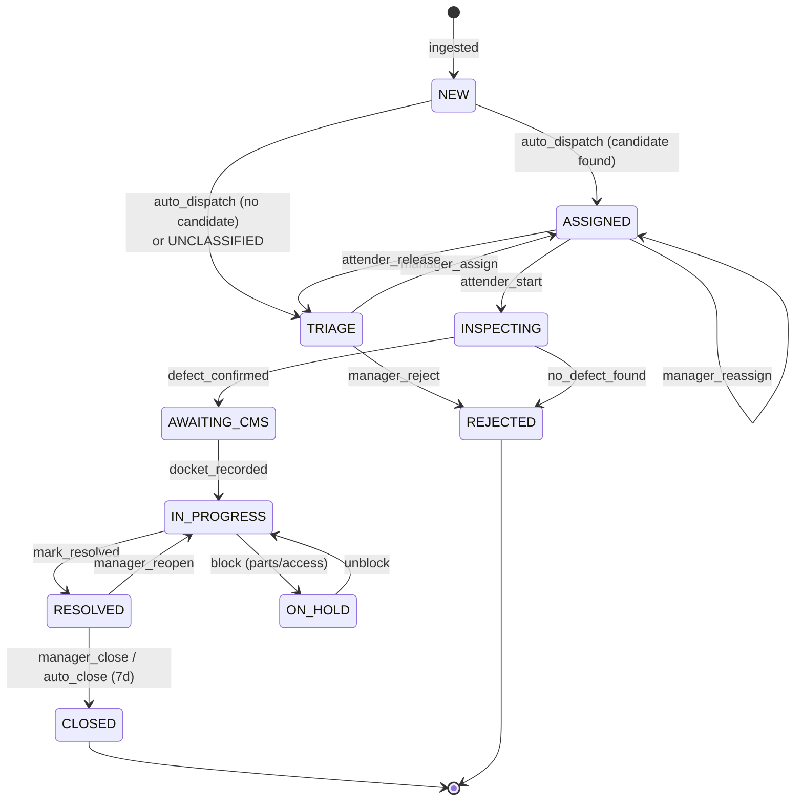
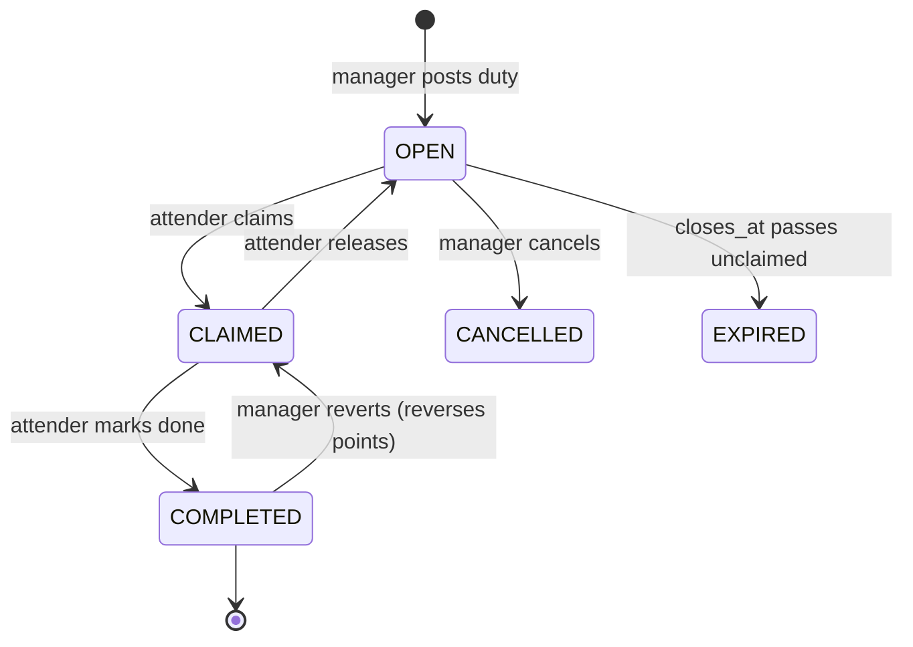

# 4. State Machines

## 4.1 Why this is formalised

Complaint status is the single most-read field in the system: it drives the attender queue, the
dashboard, SLA aging, MTTR measurement and the point credit. Leaving it as an informally-updated
string is how a ticket ends up `RESOLVED` with no docket, or credited twice.

We therefore define an explicit machine with a **guarded transition table**. The only way to change
`complaint.status` is `WorkflowService.transition(complaintId, event, actor, payload)`, which:

1. Loads the aggregate with its `version` (optimistic lock).
2. Looks up `(currentState, event)` in the table; an absent pair throws `IllegalTransition`.
3. Evaluates the guard; failure throws `GuardFailed` with a human-readable reason.
4. Applies the state change, runs the side effects and writes the audit row — all in **one
   transaction**. Notifications fire separately, on `AFTER_COMMIT` (§9.5).

There is no other write path. Controllers, the scheduler and the CSV importer all funnel here.

## 4.2 Complaint lifecycle

### Transition table

| # | From | Event | To | Actor | Guard | Side effects |
|---|---|---|---|---|---|---|
| T1 | — | `ingest` | `NEW` | System | Source row not already linked to a complaint | Create complaint, classify, set base priority + SLA due |
| T2 | `NEW` | `auto_dispatch` | `ASSIGNED` | System | Domain ≠ `UNCLASSIFIED` **and** dispatch returns a candidate | Create task + assignment, snapshot score, emit `TaskAssigned` |
| T3 | `NEW` | `auto_dispatch` | `TRIAGE` | System | Domain `UNCLASSIFIED` **or** no candidate | Record triage reason, emit `TriageRequired` |
| T4 | `TRIAGE` | `manager_assign` | `ASSIGNED` | Manager | Target attender active; domain now set | Set domain (`classified_by = MANUAL`), create task + assignment |
| T5 | `TRIAGE` | `manager_reject` | `REJECTED` | Manager | Reason mandatory | Close complaint, no points |
| T6 | `ASSIGNED` | `manager_reassign` | `ASSIGNED` | Manager | New attender ≠ current; task not yet resolved | Release old assignment, create new one, audit both |
| T7 | `ASSIGNED` | `attender_start` | `INSPECTING` | Assigned attender | Caller holds an `ACTIVE` assignment | Stamp `inspection_started_at` |
| T8 | `ASSIGNED` | `attender_release` | `TRIAGE` | Assigned attender | Reason mandatory | Release assignment, back to triage |
| T9 | `INSPECTING` | `defect_confirmed` | `AWAITING_CMS` | Assigned attender | — | Prompt for docket on mobile UI |
| T10 | `INSPECTING` | `no_defect_found` | `REJECTED` | Assigned attender | Note mandatory | Close; **no points credited** |
| T11 | `AWAITING_CMS` | `docket_recorded` | `IN_PROGRESS` | Assigned attender | Docket matches configured pattern (OQ-1) and is non-blank | Set `docket_no`, `docket_filed_at`, `docket_filed_by` |
| T12 | `IN_PROGRESS` | `block` | `ON_HOLD` | Assigned attender / Manager | Reason mandatory | Pause SLA clock |
| T13 | `ON_HOLD` | `unblock` | `IN_PROGRESS` | Assigned attender / Manager | — | Resume SLA clock, extend due date by hold duration |
| T14 | `IN_PROGRESS` | `mark_resolved` | `RESOLVED` | Assigned attender | `docket_no` is set **and** caller assignment is `ACTIVE` | **Credit points** via ledger (idempotent, §7.3); mark assignment `COMPLETED`; emit `ComplaintResolved` |
| T15 | `RESOLVED` | `manager_close` | `CLOSED` | Manager | — | Stamp `closed_at` |
| T16 | `RESOLVED` | `auto_close` | `CLOSED` | System | 7 days elapsed since resolution | Stamp `closed_at` |
| T17 | `RESOLVED` | `manager_reopen` | `IN_PROGRESS` | Manager | Reason mandatory | **Reverse the credit** (new `REVERSAL` ledger row, never a delete) |

### Notes on specific guards

**T11 — the docket gate.** `mark_resolved` (T14) requires a docket to exist. This is the mechanism
that makes the proposal's institutional-traceability requirement structurally enforced rather than
a matter of attender diligence: you cannot collect +2 points for a complaint you never filed with
the Engineering Unit. Because there is no CMS API (§1.8), we validate *format* only, and the
pattern is configuration (OQ-1) so a wrong guess costs a property change, not a redeploy.

**T17 — reopen reverses rather than deletes.** The ledger is append-only, so a reopen writes a
compensating `REVERSAL` row. The attender's balance falls by 2, and both the original credit and
the reversal remain visible in their history. Re-resolving later writes a *new* credit with a new
idempotency key (`RESOLVE:{task}:{attender}:r{n}` where `n` is the reopen count), so the
idempotency guarantee survives the reopen cycle without ever blocking a legitimate re-credit.

**T12/T13 — the SLA clock.** Hold time is excluded from SLA and from MTTR. Without this, "waiting
for the Engineering Unit to send a plumber" would be recorded as attender slowness and would
poison the bottleneck analysis in §8.

## 4.3 The CMS docket

The docket is **three columns on `complaint`**, not a state machine of its own. Its lifecycle is
already implied by the complaint's:

| Complaint state | Docket meaning |
|---|---|
| Before `AWAITING_CMS` | Not required — the defect has not been confirmed yet |
| `AWAITING_CMS` | Confirmed on site, not yet filed with the Engineering Unit |
| `IN_PROGRESS` onward | `docket_no` is set; the complaint has been filed |

Corrections overwrite `docket_no`, and `audit_event` records the old and new values, who changed it
and when. An earlier draft gave the docket its own five-state machine and a history table with a
`superseded_at` column. Both were dropped (ADR-012): the history duplicated the audit log, and the
`VERIFIED` state gated nothing by its own definition — it existed only as a bookkeeping convenience
for the manager's periodic reconciliation against the CMS portal, which is now simply a filter on
the complaint list.

## 4.4 Task lifecycle (special duties)

Special duties have no complaint and no docket. They are posted open and claimed.

For a **shared** duty (`task.shared = true`) — the common-room overhaul case from the proposal —
several attenders may hold `ACTIVE` assignments at once. The duty reaches `COMPLETED` when every
active assignee has marked their part done, and **each** assignee is credited once, guarded by
their own idempotency key `DUTY:{task_id}:{attender_id}`. The concurrency argument for this is in
§7.5.

## 4.5 Priority and aging

Priority is not a fixed label; it ages so that old low-priority work eventually surfaces above new
noise.

| Base priority | Assigned when | Initial SLA (OQ-2) |
|---|---|---|
| `P1` | Safety/utility keywords hit (`shock`, `spark`, `no water`, `sewage`, `short circuit`) | Electrical 4h · Other 8h |
| `P2` | Default for a confidently classified complaint | Electrical 8h · RO 12h · Civil 24h · Network 24h |
| `P3` | Cosmetic keywords, or explicitly downgraded by the manager | 72h |

A scheduled job escalates `P3 → P2 → P1` when a complaint has been open past **1.5×** its SLA
window without reaching `RESOLVED`, and `base_priority` is retained so the dashboard can always
show "P1 (aged from P3)". Escalation is capped at `P1`; hold time (T12) does not count toward it.
