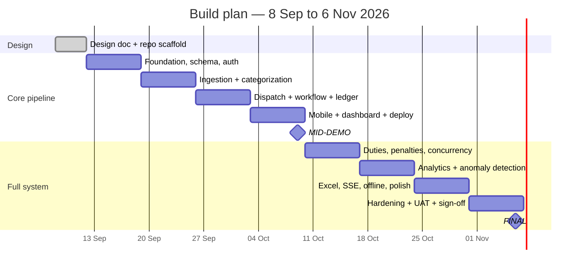

# 13. Revised Timeline

## 13.1 Fixed dates

| Milestone | Date | Days from 8 Sep |
|---|---|---|
| Design document | **11 Sep 2026** | 3 |
| Mid-demo | **9 Oct 2026** | 31 |
| Final submission | **6 Nov 2026** | 59 |

Solo developer, alongside coursework. Planned capacity **~15 hours/week**, so roughly 130 hours
total across the build. Every estimate below is sized against that, not against a full-time week.

## 13.2 Sprint plan

## 13.3 Sprint detail

Each item is tagged **[C] Core** (must ship) or **[E] Extended** (first to be cut).

### S0 · 8–11 Sep · Design & scaffold
- [C] This design document, §1–14
- [C] Repo scaffold, CI skeleton, PR workflow, branch protection
- [C] Email stakeholder with OQ-1 (docket format) and OQ-2 (SLA targets)

**Exit:** design doc merged via PR; CI green.

### S1 · 12–18 Sep · Foundation
- [C] Maven project, Spring Boot 3.x, package layout per §2.3
- [C] Flyway migrations for the full §3 schema
- [C] JPA entities with `@Version`; repositories
- [C] Spring Security: roles, password + PIN, device tokens, lockout (§11.2)
- [C] Manager provisioning screen
- [C] Testcontainers Postgres in CI; ArchUnit layering rules

**Exit:** manager and 4 attenders can log in; schema migrates clean; CI runs integration tests.

### S2 · 19–25 Sep · Ingestion & categorization
- [C] `ComplaintSource` port; Google Sheets adapter; header mapping (§5.2)
- [C] Reconciliation algorithm with `response_key` / `content_hash` (§5.3)
- [C] CSV upload adapter (Risk 1 Plan B)
- [C] Lexicon classifier with fuzzy matching; `category_term` seeding
- [C] Gold set F1 built, labelled, split; first accuracy measurement
- [C] Corner cases E1–E14
- [E] Manager lexicon editor UI

**Exit:** live sheet ingests with zero duplicates; holdout accuracy measured and reported.

### S3 · 26 Sep – 2 Oct · Dispatch, workflow, ledger
- [C] Dispatch scoring, tie-breaks, degenerate cases, score snapshot (§6)
- [C] Workflow state machine + full transition table (§4)
- [C] Append-only ledger with idempotency keys (§7.3)
- [C] Audit event writing on every transition
- [C] Priority aging + SLA computation
- [C] Concurrency tests X1, X2, X3

**Exit:** ingest → classify → dispatch → resolve → +2 credited, end to end, provably once.

### S4 · 3–9 Oct · Interfaces & deployment → **MID-DEMO**
- [C] Attender mobile queue and 4-screen resolution flow (§10.2)
- [C] Manager dashboard: counters, triage queue, complaint list
- [C] Docket entry and validation
- [C] Cloud deploy (.jar on Render/Railway) + managed Postgres
- [E] Offline service worker

**Exit / mid-demo deliverable:** automated ingestion with CSV fallback, rule-based categorization,
priority aging, floor dispatch, attender mobile with docket + points, live manager task lists,
deployed to cloud. **Matches the proposal's mid-demo commitment exactly.**

### S5 · 10–16 Oct · Duties, penalties, concurrency
- [C] Special duties: post, claim, complete (§4.4)
- [C] Penalty interface (−1) with mandatory notes
- [C] Manual adjustments and reversals
- [C] Shared-task concurrency (§7.5), pessimistic claim (§7.6)
- [C] Leaderboard (§7.8)
- [C] Concurrency suite X4–X9 complete

**Exit:** full point lifecycle correct under concurrent load; X9 passes.

### S6 · 17–23 Oct · Analytics
- [C] Stage-duration extraction from audit log
- [C] MTTR / median / p90, bottleneck identification (§8.2)
- [C] Detectors A1 (MAD outlier), A2 (chronic location), A3 (Poisson surge)
- [C] Chart.js visualizations
- [E] Detectors A4 (SLA cluster), A5 (workload imbalance)

**Exit:** dashboard shows real analytics over F4; detectors respect their `n` gates.

### S7 · 24–30 Oct · Export, real-time, polish
- [C] Apache POI multi-tab `.xlsx` daily + weekly export
- [C] SSE with outbox replay (§9.5)
- [C] Assisted admin log / `act-as` (Risk 3 Plan B)
- [C] Accessibility and mobile performance pass (§10.5–10.6)
- [E] Offline queue if deferred from S4
- [E] OpenNLP second stage (§5.7)

**Exit:** one-click export produces a clean workbook; dashboard updates live.

### S8 · 31 Oct – 6 Nov · Hardening & sign-off
- [C] Full test pass; coverage gates met
- [C] Final gold-set evaluation on holdout
- [C] Security review (§11 checklist), Gitleaks + Dependency-Check clean
- [C] Stakeholder UAT session against §12.6
- [C] README, runbook, viva preparation notes
- [C] **Stakeholder sign-off**

## 13.4 Change from the original proposal

| Change | Reason |
|---|---|
| Postgres everywhere; SQLite dropped | SQLite serialises writers and cannot demonstrate the concurrency control that is a headline feature (ADR-001) |
| OpenNLP moved to Extended, rules promoted to primary | Training data availability is unproven; rules need none and are explainable (ADR-004) |
| Auth added as explicit S1 scope | Absent from the proposal, but the schema, role matrix and deployment all depend on it |
| SSE chosen over WebSocket | One-directional need; simpler; survives PaaS proxies (ADR-003) |
| A4/A5 detectors marked Extended | Both need ≥4 weeks of history to emit anything, so they cannot be demonstrated before the final date anyway |

## 13.5 Risk buffer and cut lines

There is **no slack** in the schedule; a lost week must come out of scope, not out of quality. The
cut order is fixed in advance so the decision is not made under pressure:

1. OpenNLP second stage (§5.7)
2. Detectors A4, A5
3. Offline service worker (degrades to online-only; idempotency keys still protect retries)
4. Manager lexicon editor UI (seed via migration instead)
5. Weekly export (keep daily)

**Never cut**, because each is load-bearing for a stakeholder acceptance criterion or a core
integrity guarantee: ingestion idempotency, the ledger and its constraints, the state machine,
dispatch, the attender mobile flow, penalties, the leaderboard, daily Excel export.

| Risk | Trigger | Response |
|---|---|---|
| Sheets API access not granted in time | No credentials by 19 Sep | Build against a fixture sheet on a personal account; CSV path is unaffected |
| Real complaint data unavailable for F1 | Nothing by 19 Sep | Generate F2-style synthetic corpus; report gold-set results with that caveat stated |
| Categorization misses 90% | Holdout below target at S2 exit | Expand lexicon from misses; raise τ (trading coverage for accuracy — accuracy is the stated criterion) |
| Free-tier deploy proves unusable | Failure during S4 | Local-server fallback (§2.6) is already a designed deliverable, not a new build |
| Coursework crunch | Any sprint slips >3 days | Apply the cut list above, in order |
