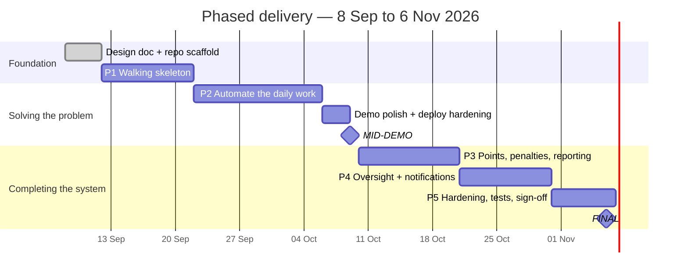

# 13. Delivery Plan

## 13.1 Strategy: a working system first, capability layered on top

The organising principle is **vertical slices, not horizontal layers**. Each phase ends with
something the stakeholder could actually use, not a tier that does nothing until the next tier
arrives. Building ingestion, dispatch, ledger and analytics in parallel and integrating at the end
is how a solo project arrives at the demo with four half-finished subsystems and nothing to show.

Two consequences shape everything below:

1. **Phase 1 is a walking skeleton.** It deliberately does the *least interesting* version of every
   step — CSV upload instead of the Sheets API, manual assignment instead of the heuristic — so that
   a complaint can travel the entire path in the deployed application within the first sprint.
   Every later phase then replaces one segment of a working pipeline rather than adding an
   unproven one.
2. **Phase 2 is the one that matters.** At the end of it the stakeholder's 30–45 minutes a day are
   gone. Everything after that improves a system that already solves the problem.

Priority is decided by one question: *does the Hostel Manager's daily workload drop without this?*
If no, it waits.

## 13.2 Fixed dates

| Milestone | Date | Requires |
|---|---|---|
| Design document | **11 Sep 2026** | This document |
| Mid-demo | **9 Oct 2026** | Phases 1–2 complete and deployed |
| Final submission | **6 Nov 2026** | Phases 3–4 complete, Phase 5 as time allows |

Solo developer alongside coursework, planned capacity **~15 h/week** — roughly 130 hours total.

---

## 13.3 Phase 1 — Walking skeleton · 12–21 Sep

> **Goal:** one complaint travels the whole path, in the deployed app. Nothing clever.

| # | Item | Why it is in Phase 1 |
|---|---|---|
| 1.1 | Maven project, package layout (§2.3), ArchUnit rules | Structure is cheapest to establish before there is code |
| 1.2 | Flyway migrations: `app_user`, `floor`, `floor_assignment`, `complaint`, `task`, `task_assignment`, `point_ledger`, `audit_event` | The spine of the schema |
| 1.3 | Auth: **Google sign-in with an allowlist** for every user, provisioning screen, two seeded `MANAGER` rows | Nothing is usable without login. Google Cloud console setup (consent screen, two redirect URIs) happens here |
| 1.4 | **CSV upload** → complaint created | Proves ingestion *without* depending on Google API credentials arriving on time |
| 1.5 | Manager list view + **manual assign** to an attender | The heuristic can wait; the assignment concept cannot |
| 1.6 | Attender mobile queue → *Resolve* → **+2 ledger row** | Proves the ledger and the idempotency key end to end |
| 1.7 | Leaderboard (`SUM` over the ledger) | The stakeholder's second-biggest pain, and nearly free once the ledger exists |
| 1.8 | Deploy to Render + managed Postgres; CI green with Testcontainers | Deploying on day 10 rather than day 40 is where deployment surprises are cheap |

**Exit criterion:** on the deployed URL, the manager uploads a CSV, assigns a complaint to Ravi;
Ravi opens it on his phone, taps Resolve; the leaderboard shows +2. **That is a working system** —
thin, but real.

**Explicitly not in Phase 1:** Google Sheets, categorization, the dispatch heuristic, dockets, SLA,
push, analytics, Excel.

---

## 13.4 Phase 2 — Automate the daily work · 22 Sep – 5 Oct

> **Goal:** the manager stops touching the spreadsheet. This is the phase that solves the problem.

| # | Item | Replaces |
|---|---|---|
| 2.1 | `ComplaintSource` port; Google Sheets adapter with header mapping (§5.2) | 1.4's CSV-only input (CSV stays as the fallback adapter) |
| 2.2 | `response_key` dedupe + single-mode scan (§5.3); scheduled poll + **Sync Now** | Manual copy-paste |
| 2.3 | Rule + fuzzy lexicon classifier with confidence gate (§5.5) | Manual sorting into domains |
| 2.4 | **Triage queue** — one-click domain + assign for low-confidence items | The safety net that makes 2.3 trustworthy |
| 2.5 | Auto-dispatch: Floor + Load scoring, tie-breaks, `score_snapshot` (§6) | 1.5's manual assignment |
| 2.6 | Full state machine + transition table (§4), replacing ad-hoc status writes | Ad-hoc updates |
| 2.7 | Docket entry + the `mark_resolved` guard (T11, T14) | Verbal chasing of inspection IDs |
| 2.8 | Priority assignment, SLA due dates, aging job (§4.5) | Required for the mid-demo commitment |
| 2.9 | Gold set built and labelled; first accuracy + coverage measurement (§12.3) | The 90% acceptance criterion becomes measurable |

**Exit criterion — the important one:** a complaint submitted to the Google Form appears
categorized and assigned, on the right attender's phone, **with no human action in between**. The
manager's daily 30–45 minutes is gone.

---

## 13.5 Phase 3 — Complete the points story · 10–20 Oct

> **Goal:** the manual month-end tally disappears too.

| # | Item |
|---|---|
| 3.1 | Penalty interface (−1) with mandatory notes; manual adjustments and reversals |
| 3.2 | Special duties: manager posts with custom points, attender claims and completes (§4.4) |
| 3.3 | Monthly period handling, `effective_date`, backdating into a closed period with a warning (§7.9) |
| 3.4 | Apache POI daily + weekly `.xlsx` export |
| 3.5 | Complaint detail screen: full audit timeline, score breakdown, docket history |
| 3.6 | **Assisted admin log** (`act-as`) — manager records progress during roll-call (Risk 3 Plan B) |

**Exit criterion:** the manager can run a full month — points, penalties, duties, export — without
opening a spreadsheet.

---

## 13.6 Phase 4 — Oversight and reach · 21–30 Oct

> **Goal:** things the manager could never do before, and reaching attenders without them looking.

| # | Item |
|---|---|
| 4.1 | **Web Push** to attender phones: VAPID, subscription endpoints, service worker, settings (§9.6) |
| 4.2 | SSE live dashboard: activity feed, live counters, live leaderboard (§9.5) |
| 4.3 | **Shared-task concurrency**: multi-assignee duties, per-assignee credit, OCC completion (§7.5) |
| 4.4 | Analytics: stage durations from the audit log, MTTR / median / p90, bottleneck identification |
| 4.5 | Anomaly detectors A1 (MAD outlier), A2 (chronic location), A3 (Poisson surge) with their `n` gates |
| 4.6 | Chart.js dashboard visualizations, each showing its sample size |

**Exit criterion:** a P1 assignment buzzes the attender's phone within 30 s, and the dashboard shows
real MTTR and anomaly alerts over accumulated data.

---

## 13.7 Phase 5 — Hardening and sign-off · 31 Oct – 6 Nov

| # | Item |
|---|---|
| 5.1 | Full test pass; coverage gates; the complete concurrency suite (X1–X9) |
| 5.2 | Final gold-set evaluation on the holdout |
| 5.3 | Security review (§11), Gitleaks and Dependency-Check clean |
| 5.4 | Accessibility and mobile performance pass (§10.5–10.6) |
| 5.5 | Standby deployment runbook (§2.6) and a rehearsed failover |
| 5.6 | **Stakeholder UAT** against §12.6; README, runbook, viva notes |
| 5.7 | **Sign-off** |

---

## 13.8 Backlog — deliberately not scheduled

Genuinely optional. Each is additive, and none is required by an acceptance criterion. They are
listed so the decision to skip them is visible rather than silent.

| Item | Condition for building it |
|---|---|
| **Amendment tracking** for edited Form responses (§5.3) | Only if the Form has "edit response" enabled. Schema already reserves the `AMENDED` state |
| **Offline replay queue** (IndexedDB + service worker) | If attenders report losing actions in poor signal. Push already needs the service worker; this is the replay half only |
| **OpenNLP second stage** (§5.7) | Once enough triage corrections have accumulated to train on |
| Detectors **A4** (SLA cluster) and **A5** (workload imbalance) | Both need ≥4 weeks of history to emit anything, so neither can be demonstrated before 6 Nov anyway |
| Manager-editable lexicon UI | If the manager wants to tune categorization without a redeploy. Seeded by migration until then |
| Deletion detection (`VANISHED`) | Only if the manager reports deleting rows and wanting to know |

## 13.9 Changes from the original proposal

| Change | Reason |
|---|---|
| Delivery reorganised into vertical phases | A solo project integrating four subsystems at the end is the main schedule risk; a thin working system by 21 Sep removes it |
| One PostgreSQL everywhere; SQLite and H2 dropped | SQLite cannot demonstrate the concurrency control; the H2 standby left work with no path back to the cloud database (ADR-001) |
| Auth added as explicit Phase 1 scope | Absent from the proposal, but the schema, role matrix and deployment all depend on it |
| Rules-first classification; OpenNLP to backlog | Training-data availability is unproven; rules need none and are explainable (ADR-004) |
| SSE over WebSocket, without replay machinery | One-directional need; a refetch on reconnect gives the same screen (ADR-003) |
| **Push notifications to attenders added** | Stakeholder requirement after the proposal; reuses the service worker (ADR-011) |
| Eight mechanisms simplified or removed | Sized for a system with <10 users, and for a viva where every line must be explainable (ADR-012) |

## 13.10 Risk and the cut line

There is **no slack**; a lost week comes out of scope, not quality. Because the phases are ordered
by value, the cut line is simply *how far down §13.6 and §13.7 we get* — and the system remains
useful at every point, which is the whole reason for slicing it this way.

| Risk | Trigger | Response |
|---|---|---|
| Sheets API credentials not granted in time | Nothing by 22 Sep | Phase 1 already ships on CSV; build 2.1 against a personal test sheet |
| Real complaint data unavailable for the gold set | Nothing by 22 Sep | Use a synthetic corpus and state that caveat with the accuracy figure |
| Categorization misses 90% | Holdout below target at Phase 2 exit | Expand the lexicon from observed misses; raise τ, trading coverage for accuracy since accuracy is the stated criterion |
| Free-tier deploy proves unusable | Failure during Phase 1 | Found on day 10 rather than day 40 — that is why 1.8 is in Phase 1 |
| Coursework crunch | Any phase slips >3 days | Drop from the bottom of Phase 4, then Phase 5.5. Never cut Phases 1–3 |

**Never cut**, because each is load-bearing for a stakeholder acceptance criterion or a core
integrity guarantee: ingestion idempotency, the ledger and its constraints, the state machine,
dispatch, the attender mobile flow, penalties, the leaderboard, and the daily Excel export.
